# Tahoe: macOS Tahoe glass for Discord on Windows

A theme for Discord on Windows with [Equicord](https://github.com/Equicord/Equicord): a floating glass
sidebar over Windows 11's Acrylic or Mica, SF Symbols in menus and toolbars, liquid-glass controls
and flat Windows 11 window buttons.

A Windows port of [skopevoj/tahoe-discord-theme](https://github.com/skopevoj/tahoe-discord-theme),
the original theme for Vesktop on macOS.

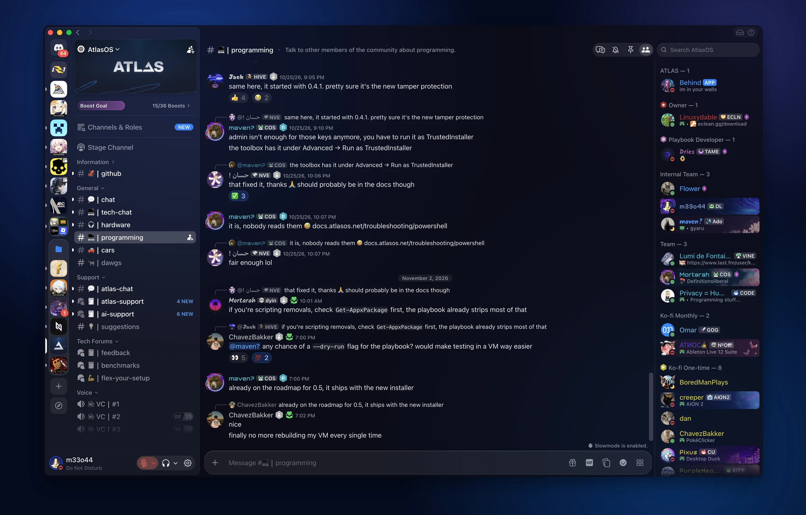

<sub>The screenshots are from the macOS original. On Windows the window corners are Windows 11's and
minimise, maximise and close sit top right.</sub>

## More screens

**Forum with a post open**

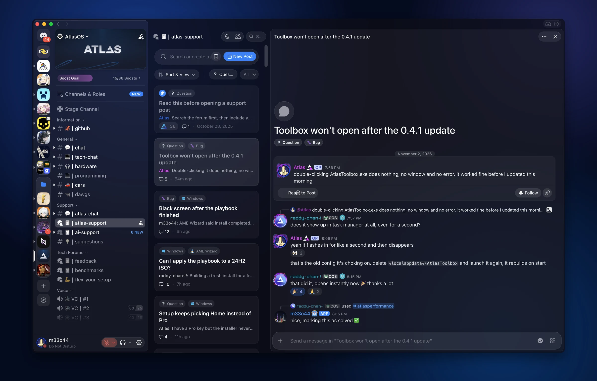

**A thread beside its channel**

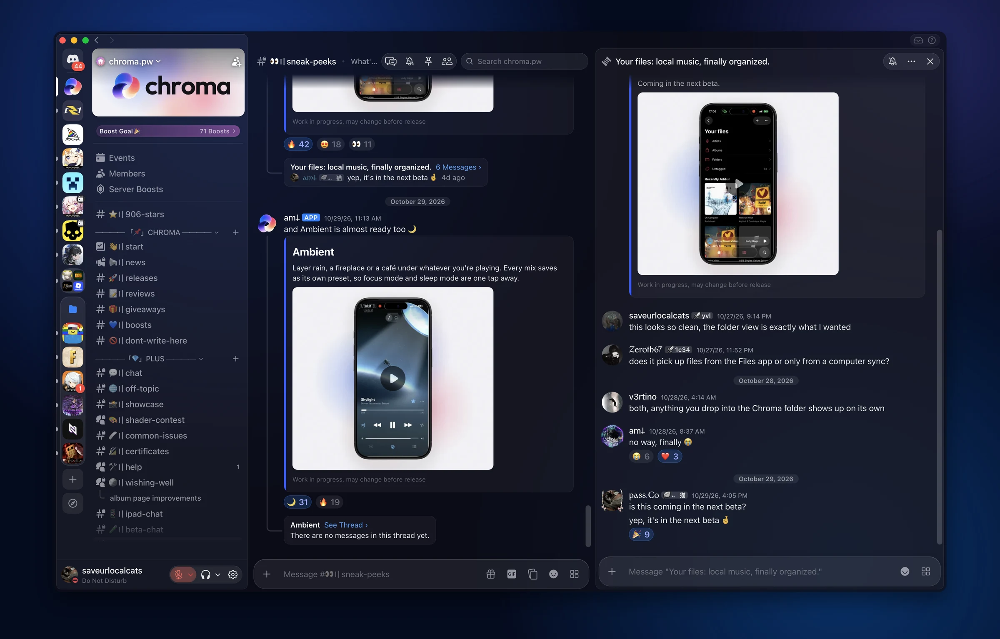

## Install on Windows

1. Discord settings, **Equicord** section:
   - turn **Enable Window Transparency** off. On Windows it stops the window resizing and snapping
     to screen edges, and shows the desktop sharp, unblurred, behind the text;
   - set **Background Material** to **Acrylic** (the blurred desktop, closest to macOS vibrancy) or
     **Mica** (a calmer wallpaper tint). It needs Windows 11 22H2 or later;
   - quit Discord completely (tray icon > **Quit Discord**) and start it again.
2. Put [`theme/Tahoe.theme.css`](theme/Tahoe.theme.css) in the themes folder
   (**Equicord > Themes > Open Themes Folder**, or `%APPDATA%\Equicord\themes`) and enable it.

The theme file only imports `build/tahoe.css` from GitHub Pages and holds your settings, so every
device picks up new versions on its own.

On Windows 10, or with Background Material left at **None**, set `--vg-vibrancy: off` (below) for a
solid window instead of glass.

From a clone, with [Node.js](https://nodejs.org), `install.ps1` builds the theme with the bundle
inlined, so it needs no network, and copies it into Equicord's themes folder:

```powershell
powershell -ExecutionPolicy Bypass -File install.ps1
```

## Options

Set in the `:root` block of the theme file; every option is `on` or `off`.

| Option | Default | Effect |
|---|---|---|
| `--vg-animations` | on | off: transitions and motion jump to their end state |
| `--vg-sf-symbols` | on | off: Discord's own icons instead of SF Symbols |
| `--vg-vibrancy` | on | off: solid window and sidebar, for Background Material "None" or Windows 10 |
| `--vg-background-image` | off | on: `--vg-background-image-url` as the window background; menus become real blurred glass |
| `--vg-panel-art` | on | off: hides Nitro artwork and avatar decoration in the user panel |
| `--vg-compact` | off | on: shorter rows in the channel list, member list and menus |
| `--vg-scroll-fade` | on | off: lists end in a hard edge instead of fading under the bars |

| `--vg-vibrancy: on` | `--vg-vibrancy: off` |
|---|---|
| 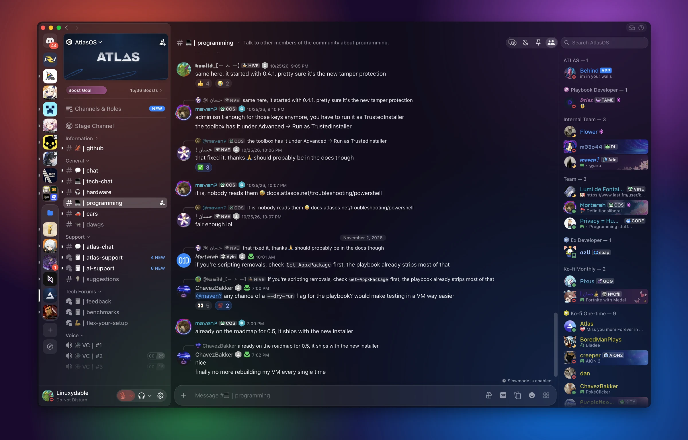 | 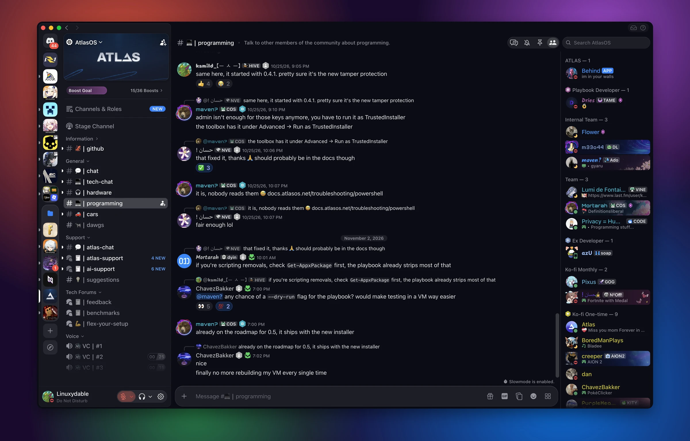 |

| `--vg-sf-symbols: on` | `--vg-sf-symbols: off` |
|---|---|
| 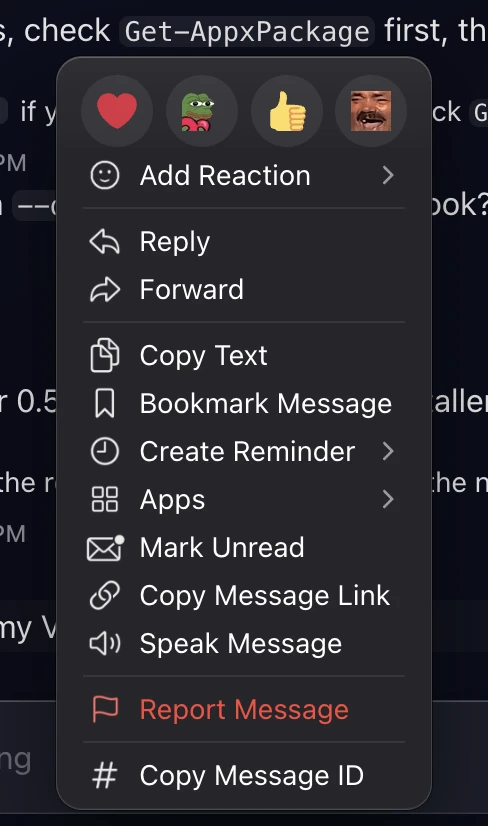 | 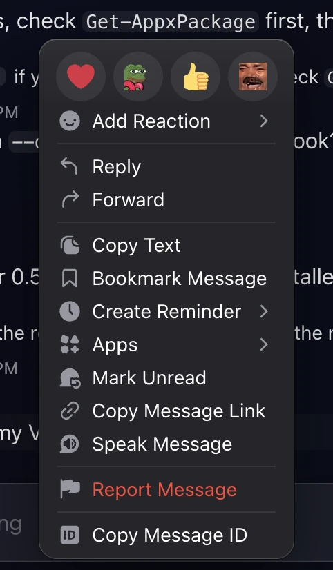 |

| `--vg-compact: off` | `--vg-compact: on` |
|---|---|
| 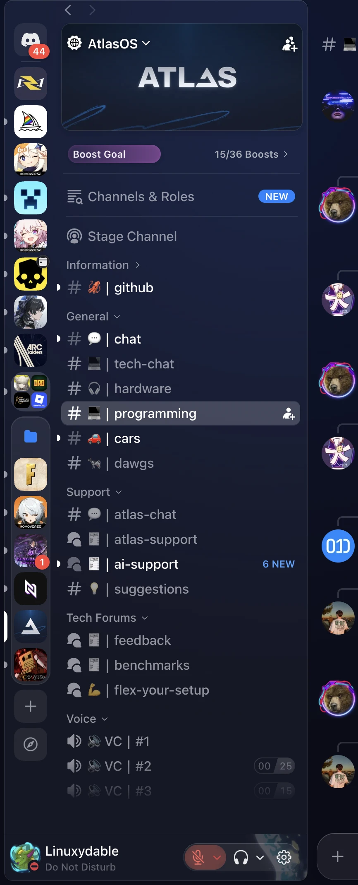 | 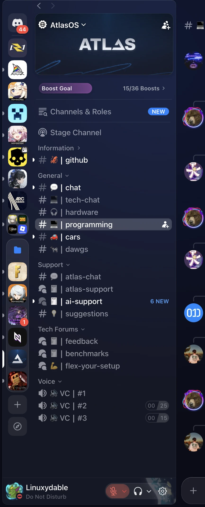 |

| `--vg-panel-art: on` | `--vg-panel-art: off` |
|---|---|
| 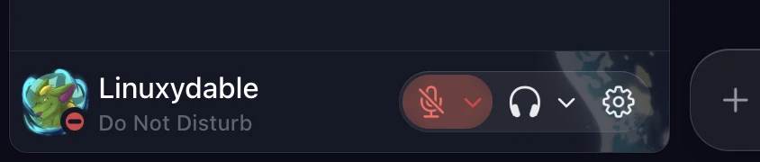 | 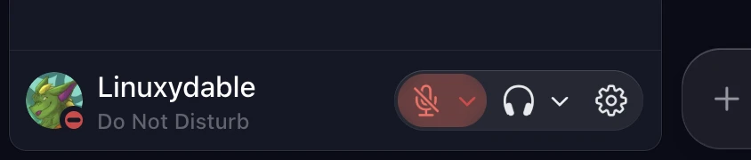 |

**`--vg-background-image: on`**: your image as the window background; menus and popouts become real blurred glass.

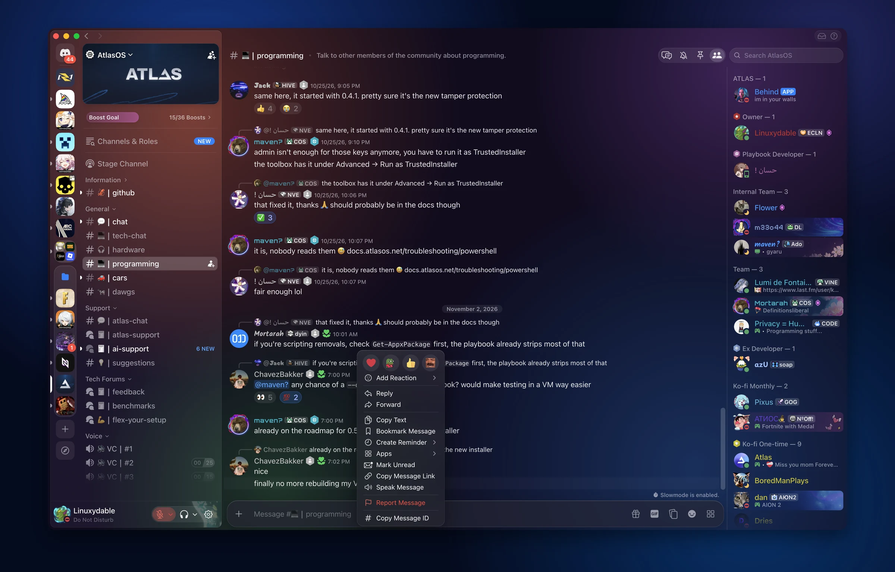

Colours (`--vg-accent`, `--vg-tint`, `--vg-window`, `--vg-panel`…), geometry and fonts are below the
options in the same block; [`src/tokens.css`](src/tokens.css) lists every token with its default,
and [`src/windows.css`](src/windows.css) the defaults Windows changes. Options are style container
queries (`@container style(--vg-x: off)`), see [`src/options.css`](src/options.css).

## What's different from the macOS original

- **Window buttons.** The original hides Discord's minimise, maximise and close because macOS draws
  its own; on Windows they are the only ones. They are flat Windows 11 caption buttons, flush with
  the corner, with the caption red on close.
- **Glass.** Equicord's Background Material (Acrylic or Mica) takes the place of macOS vibrancy, so
  the window keeps resizing and snapping; `--vg-vibrancy: off` gives the solid window without it.
- **Geometry.** Windows 11's 8px window corner, with the floating panels at Fluent's 8px instead of
  macOS's concentric 10px; the panels reach up behind Discord's own titlebar height.
- **Fonts.** SF Pro and SF Mono when installed, else Segoe UI Variable and Cascadia Mono.
- **Equicord's own UI.** Its switches and plugin cards take the theme, alongside Vencord's.
- **Scroll fades.** Every scroller's fade mask states `mask-size: 100% 100%`: Discord's Chromium on
  Windows mis-sizes one left at the default, which blanked the whole message list.
- **Scrolling.** Discord restyles the whole message list each time a scroll starts and stops. Rules
  with a `:has()` above the element they style (`X:has(A) Y`) made each of those restyles about 4.5
  times Discord's own cost. `X:has(A)` now only sets a flag (`--vg-is-…: 1`) and the rules for its
  parts sit in `@container style(--vg-is-…: 1)`: the same look, each hitch about a third shorter
  (≈360 → ≈230 ms with 80 messages loaded, against ≈80 ms without a theme).
- **Build.** A Node build (`build.mjs`) and a PowerShell installer replace the Python and shell
  tooling, and there are no flavors yet.

## Layout

| Path | What |
|---|---|
| `theme/Tahoe.theme.css` | the file you install: import + settings |
| `src/main.css` | the module list, in cascade order |
| `src/*.css` | the modules: `tokens`, `palette` (Discord's variables), `base`, `layout`, `titlebar`, `sidebar`, `toolbar`, `chat`, `people`, `floating` (menus, popouts, modals, settings), `controls`, `serverlist`, `composer`, `media` (image viewer), `threads` (threads and forums), `forms` (settings controls), `notices`, `store` (Nitro, Shop, Discover), `calls`, `options`, `icons` (generated), `windows` (Windows window buttons, titlebar and defaults) |
| `build/tahoe.css` | the bundle served by GitHub Pages; commit it after every change |
| `build.mjs` | builds the bundle, and `build/Tahoe.local.theme.css` (bundle inlined, git-ignored) for local use |
| `install.ps1` | builds and copies the local theme file into Equicord |
| `tools/sf/` | SF Symbols: `icons.json` maps Discord selectors to symbol names, `build.py` renders them into `src/icons.css` (needs macOS) |
| `tools/check-classes.mjs` | Discord class checker |
| `tools/cdp.mjs` | screenshots, CSS injection and JS in the running Discord |
| `docs/discord-variables.txt` | Discord's CSS variables and their default values |

## Develop

```powershell
powershell -ExecutionPolicy Bypass -File install.ps1   # build and load your working copy into Equicord
node tools/check-classes.mjs                           # after a Discord update
```

`install.ps1` copies `build/Tahoe.local.theme.css` (bundle inlined, no network) into Equicord as
`Tahoe.theme.css`, and Equicord reloads it as soon as the file changes.

**Class checker.** Selectors match Discord's hashed classes by stem (`[class*="listItem_"]`), which
survives the hash changing but not a rename. `tools/check-classes.mjs` compares every stem with a
public dump of Discord's current classes (`--canary` for what is coming) and lists dead stems
(exit 1).

**Performance.** Keep every `:has()` on the element a rule styles. A `:has()` above it
(`X:has(A) Y`) makes each DOM change in Discord restyle whole lists at several times the cost; let
`X:has(A)` set a flag and put the rules for X's parts in `@container style(--vg-is-…: 1)`, as
`src/threads.css` does. `tools/cdp.mjs` drives a Discord started with a debug port (see its
header) for checking changes live.

## Publish

Commit `src/` and `build/`, push; GitHub Pages serves the repository (branch `main`, folder `/`).
Equicord only loads remote CSS from a few hosts, and only GitHub Pages serves it as `text/css`;
`raw.githubusercontent.com` is `text/plain` with `nosniff`, which Chromium refuses as a stylesheet.

## Credits

The design, the theme and its tooling are [skopevoj](https://github.com/skopevoj)'s
[Tahoe](https://github.com/skopevoj/tahoe-discord-theme) for Vesktop on macOS; this repository adapts
it to Discord on Windows with Equicord.
